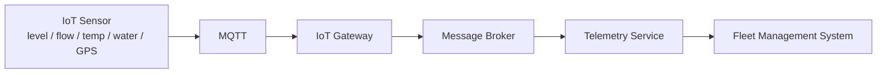

# IoT Integration

## Target architecture (spec section 21)

Future sensor types: tank level sensors, flow meters, temperature sensors,
water detection, GPS (for mobile refuellers), RFID (asset tracking), and
eventual PLC/SCADA integration at larger fuel farms.

## What's built in this MVP

`iot_devices` and `iot_readings` tables, plus:

- `GET /api/v1/iot/devices?airportId=` — registered devices
- `POST /api/v1/iot/devices` — register a device against a tank or refueller
- `GET /api/v1/iot/devices/:id/readings` — recent readings
- `POST /api/v1/iot/readings` — **simulated** ingest endpoint

The seed script (`apps/api/src/seed/seed.ts`) registers a handful of
`level_sensor` devices and generates simulated historical readings, so the
data model and read paths can be exercised end-to-end today.

## What's explicitly not built

`POST /iot/readings` stands in for the Telemetry Service's write path. A
real deployment would **not** expose a public POST endpoint for sensor
data — it would run an MQTT broker (e.g. Mosquitto or a managed IoT Core
service), a gateway process subscribing to sensor topics, and a telemetry
service that validates and writes readings server-side, with sensors never
talking to the REST API directly. This is flagged as
`TODO / FUTURE INTEGRATION` directly in the route source
(`apps/api/src/routes/iot.ts`) and in the IoT Devices screen in the web app.

## Why simulate rather than build the full pipeline

Standing up MQTT infrastructure, device provisioning/auth, and a telemetry
ingestion service is a substantial, mostly infrastructure-shaped project
independent of the fuel-management business logic this MVP is proving out.
Simulating readings at the data layer lets every downstream consumer —
tank dashboards, the low-stock alerting logic, future predictive
maintenance — be built and tested against realistic data now, with the
actual ingestion pipeline swappable in later without changing anything
above the `iot_readings` table.

## Fleet telematics (Teltonika FMB125)

Vehicle GPS/AVL telemetry is a separate, already-built pipeline from the
fuel-sensor IoT above. Teltonika FMB125 trackers forward rich JSON (GNSS +
AVL IO element map) to the FMS ingest endpoint
`POST /api/telemetry/ingest`, authenticated with
`Authorization: Bearer <TELEMETRY_INGEST_TOKEN>`. The endpoint resolves the
device IMEI to a vehicle, stores the position idempotently, interprets IO
elements into `fleet_exceptions` alerts (overspeed, idling, unplug, towing,
crash, geofence, immobilizer, eco driving) and derives refuel/drain events
from fuel-level deltas.

See `MESHSAT_INTEGRATION.md` section 8 for the full endpoint contract, IO
mapping table, and device-registration steps, and `API.md` for the
client-scoped read/report endpoints (`/api/telemetry/latest`,
`/summary`, `/export`).

### IO-ID → feature map (`io_feature_map`)

The device's raw IO element map is decoded through a configurable
`io_feature_map` (admin-editable via `GET/POST/PUT/DELETE /api/v1/settings/io-features`,
surface in the Settings page). Defaults seeded on first run:

| IO ID | Feature key | Label | Type |
|---|---|---|---|
| 12 | `fuel_counter_12` | GNSS Fuel Counter (primary) | scalar |
| 13 | `fuel_counter_13` | GNSS Fuel Counter (secondary) | scalar |
| 255 | `overspeed` | Overspeeding | event |
| 253 | `eco_accel` | Eco Driving — Harsh Acceleration | event |
| 254 | `eco_brake` | Eco Driving — Harsh Braking | event |
| 251 | `idling` | Excessive Idling | event |
| 252 | `power_unplug` | Power Unplug / Tamper | event |
| 246 | `towing` | Towing Detected | event |
| 247 | `crash` | Crash Detection | event |
| 175 | `geofence_auto` | Auto / Manual Geofence | event |
| 174 | `geofence_zone` | Geofence Zone Event (IO 155–174) | event |
| 179 | `immobilizer` | DOUT1 / Immobilizer | boolean |
| 179 | `dout_ignition` | DOUT Driven by Ignition | boolean |
| 249 | `jamming` | Network Jamming | event |
| 78 | `ibutton` | iButton / Driver ID Read | scalar |

`GET /api/telemetry/features/:imei` returns each feature with its latest decoded
value alongside recent telemetry events. Because the mapping lives in the
database, changing the FMB125 Configurator IO assignment (or adding a new
element) needs no code change — add/edit the row instead.

### Parameter-ID map (`param_map`)

Remote `setparam` commands reference a Teltonika parameter ID resolved through
the configurable `param_map` (admin-editable via `/api/v1/settings/param-map`).
Defaults seeded on first run:

| Feature key | Param ID | Description |
|---|---|---|
| `overspeed_threshold` | 1580 | Overspeeding threshold (km/h) |
| `idling_timeout` | 1581 | Excessive idling timeout (seconds) |
| `eco_driving_threshold` | 1582 | Eco (green) driving sensitivity |
| `geofence_radius` | 2051 | Auto geofence radius (metres) |
| `immobilizer_dout` | 1028 | DOUT1 / immobiliser control |

### Remote configuration & control (Codec 12)

Users with an elevated role (`admin`, `fleet_admin`, `fleet_manager`) can push
Codec-12 commands (`setparam`, `setdigout`, `raw`) to a tracker through
`POST /api/telemetry/commands`. Commands are queued in `device_commands` and
forwarded to the MeshSat relay for delivery over the tracker's next TCP session.
See `MESHSAT_INTEGRATION.md` section 9 for the command flow.
